 

## `$ whoami`

I'm a **software engineer** who builds AI-powered products end-to-end, from the data model and API contracts to the interface and the deploy pipeline. I care about systems that are **correct, observable and built to scale**, and about turning LLMs into dependable features rather than demos.

- ⚡ **Engineering focus:** LLM applications, retrieval-augmented generation, agent workflows, and the backend platforms that run them
- 🏗️ **How I build:** typed contracts, automated tests, CI/CD, containerised services, security and compliance from day one
- 🛰️ **Currently:** building AI-driven support and fintech-platform tooling, and exploring multi-agent orchestration

## `$ ls ./stack`

**Languages** 

**Frontend** 

**Backend & Data** 

**Cloud & DevOps** 

**AI / ML** 

## `$ ls ./projects --featured`

<table>
<tr>
<td width="50%" valign="top">

### 🤖 [RBP Finivis Support Assistant](https://github.com/Abhinav1299dev/rbp-finivis-support-assistant)
`Python` `Flask` `OpenAI` `pytest` 
Grounded FAQ assistant with rule-based escalation (complaints, transaction issues, high-value transfers), refusal when the FAQ has no answer, and structured JSONL audit logging, ground based answer.

</td>
<td width="50%" valign="top">

### ⚡ [Real-Time Orders System](https://github.com/Abhinav1299dev/real-time-orders-system)
`Node.js` `PostgreSQL` `Socket.IO` 
Event-driven order tracking using PostgreSQL `LISTEN/NOTIFY` to push live updates to clients over WebSockets, with no polling.

</td>
</tr>
<tr>
<td width="50%" valign="top">

### 🧠 [NLP Model Comparison & Explainability](https://github.com/Abhinav1299dev/NLP-Model-Comparison-and-Explainability)
`Python` `NLP` `Gradio` `XAI` 
Benchmarks independent NLP models across diverse corpora behind one Gradio interface, with performance analysis and explainability.

</td>
<td width="50%" valign="top">

### 🎯 InternSetu: AI Internship Platform
`Node.js` `PostgreSQL` `OpenAI API` 
AI-powered matching between candidates and internships. 🏅 **Smart India Hackathon 2025 Finalist.**

</td>
</tr>
<tr>
<td width="50%" valign="top">

### ⛏️ [ML Coal Prediction](https://github.com/Abhinav1299dev/Coal-prediction-ML-project)
`Python` `Machine Learning` 
Predictive model for coal-related outcomes at **~89% accuracy and logistic regression and decision tree used**.

</td>
<td width="50%" valign="top">

### 📊 [Pharma Insights](https://github.com/Abhinav1299dev/Pharma-Insights)
`Python` `SQL` `Analytics` 
Healthcare data analysis that turns raw records into actionable insights for data engineering and data visualizations

</td>
</tr>
</table>

<b>More builds</b>

 

- 🏥 **Explainable AI Healthcare Navigation** (`LLMs` · `RAG` · `XAI`): evidence-backed, explainable recommendations,relates insurance policy, user requirements and hospital provider datas simultaneouly.
- 💬 **AyuGPT** (`LLMs`): AI assistant for healthcare information and guidance related to ayurveda and its featues
- 🌐 **[MERN Stack Project](https://github.com/Abhinav1299dev/MERN-stack-project)** (`MongoDB` · `Express` · `React` · `Node`)
- 🌍 **IoT Monitoring Systems** (`IoT` · `Embedded`): weather reporting, flood monitoring and fire detection for safety warning

## `$ git log --stats`

<picture>
  <source media="(prefers-color-scheme: dark)" srcset="https://raw.githubusercontent.com/Abhinav1299dev/Abhinav1299dev/output/snake-dark.svg">
  
</picture>

## `$ cat roadmap.md`

| Track | Next |
|---|---|
| 🤖 **Agentic AI** | Multi-agent orchestration, tool use, evaluation harnesses |
| 🔎 **Retrieval** | Hybrid search, re-ranking, production RAG observability |
| ☁️ **Platform** | Kubernetes, IaC with Terraform, cost-aware cloud architecture |
| 🏗️ **Architecture** | Distributed systems, event-driven design, multi-tenant SaaS |
| 🌍 **Open source** | Contributing to AI and developer-tooling projects |

### `> Building intelligent software that creates real-world impact.`

⭐ If something here is useful, a star is always appreciated.

